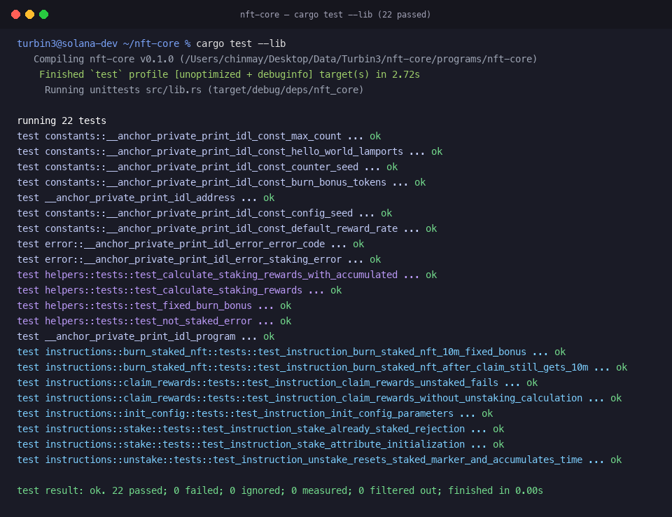

# NFT Staking Core

A high-performance Solana staking program built with **Anchor** and the **Metaplex Core** digital asset standard, utilizing Core's native composable plugin architecture (`Attributes`, `FreezeDelegate`, and `BurnDelegate`).

---

## 🌟 Overview & Key Features

This program implements non-custodial staking for Metaplex Core NFTs, allowing assets to remain in the user's wallet while being frozen and managed via Core Plugins.

### 1. Claim Rewards Without Unstaking (`claim_rewards`)
- Allows users to claim accrued staking rewards at any time without unstaking their NFT.
- Mints reward tokens directly to the user's Associated Token Account (ATA) via Cross-Program Invocation (CPI) to the SPL Token Program using the `StakeConfig` PDA as the mint authority.
- Updates the `staked` timestamp attribute to the current time, resetting the accrual counter without touching the `FreezeDelegate`.
- **The NFT remains securely staked and frozen throughout the transaction.**

### 2. Burn-to-Earn with BurnDelegate (`burn_staked_nft`)
- Users can permanently burn their staked NFT in exchange for all accumulated staking rewards **plus a massive fixed bonus of 10,000,000 tokens**.
- Mints `accumulated_rewards + 10_000_000` reward tokens to the user's ATA.
- Utilizes the `BurnDelegate` plugin attached during staking to permanently destroy the asset via Metaplex Core `BurnV1` CPI.
- Automatically decrements the collection-level `"total_staked"` counter.

### 3. Collection-Level Staking Stats (Attributes on Collection)
- Tracks global staking statistics directly on the **Collection account** using its native `Attributes` plugin.
- Maintains a `"total_staked"` counter attribute.
- **Increments** automatically on `stake`.
- **Decrements** automatically on `unstake` and `burn_staked_nft`.

---

## 🏗️ System Architecture

The following diagram illustrates the lifecycle of an NFT, the interaction with Metaplex Core plugins, and the reward distribution flow:

```mermaid
flowchart TD
    subgraph Client["User & Authority"]
        U["NFT Owner / Staker"]
        A["Admin / Update Authority"]
    end

    subgraph Program["nft_core Program (Anchor)"]
        IC["init_config"]
        S["stake"]
        CR["claim_rewards"]
        BSN["burn_staked_nft"]
        US["unstake"]
    end

    subgraph State["On-Chain State & PDAs"]
        SC[("StakeConfig PDA<br/>[stake_config, collection]<br/>- reward_rate<br/>- burn_bonus: 10M<br/>- reward_mint")]
    end

    subgraph MPL["Metaplex Core Program"]
        subgraph Asset["Core Asset (NFT)"]
            AttrAsset["Attributes Plugin<br/>• staked: timestamp<br/>• staked_time: duration"]
            FD["FreezeDelegate Plugin<br/>• frozen: true"]
            BD["BurnDelegate Plugin<br/>• delegate burn rights"]
        end

        subgraph Collection["Core Collection"]
            AttrCol["Attributes Plugin<br/>• total_staked: counter"]
        end
    end

    subgraph Token["SPL Token Program"]
        RM["Reward Token Mint"]
        ATA["User Reward ATA"]
    end

    %% Init Config Flow
    A -->|Initialize parameters| IC
    IC -->|Create PDA| SC

    %% Stake Flow
    U -->|1. Stake NFT| S
    A -.->|Co-sign update| S
    S -->|Write staked timestamp| AttrAsset
    S -->|Freeze NFT in wallet| FD
    S -->|Attach burn delegate| BD
    S -->|Increment counter (+1)| AttrCol

    %% Claim Rewards Flow
    U -->|2. Claim without unstaking| CR
    CR -->|Read elapsed time| AttrAsset
    CR -->|Sign via PDA seeds| SC
    SC -->|CPI mint_to accrued| RM
    RM -->|Transfer tokens| ATA
    CR -->|Reset staked timestamp to now<br/>(NFT stays frozen)| AttrAsset

    %% Burn to Earn Flow
    U -->|3. Burn to Earn| BSN
    BSN -->|Read elapsed time| AttrAsset
    BSN -->|Sign via PDA seeds| SC
    SC -->|CPI mint_to accrued + 10M bonus| RM
    RM -->|Transfer tokens| ATA
    BSN -->|Remove Freeze & BurnV1 CPI| Asset
    BSN -->|Decrement counter (-1)| AttrCol

    %% Unstake Flow
    U -->|4. Unstake| US
    US -->|Set staked: 0| AttrAsset
    US -->|Remove FreezeDelegate| FD
    US -->|Remove BurnDelegate| BD
    US -->|Decrement counter (-1)| AttrCol
```

---

## 🔍 Detailed Instruction Breakdown

| Instruction | Key Accounts | Actions & Plugins |
| :--- | :--- | :--- |
| `init_config` | `authority`, `payer`, `config`, `collection`, `reward_mint` | Creates `StakeConfig` PDA storing reward rate and 10,000,000 token burn bonus. |
| `stake` | `owner`, `update_authority`, `payer`, `asset`, `collection` | 1. Writes `staked: <now>` and `staked_time: 0` to asset Attributes.<br/>2. Adds `FreezeDelegate` (`frozen: true`).<br/>3. Adds `BurnDelegate`.<br/>4. Increments `"total_staked"` on collection Attributes. |
| `claim_rewards` | `owner`, `update_authority`, `config`, `reward_mint`, `user_reward_ata` | 1. Calculates rewards: `(now - staked + accumulated) * rate`.<br/>2. Mints reward tokens to ATA via PDA signer.<br/>3. Resets `staked` to current time.<br/>4. **NFT remains staked and frozen.** |
| `burn_staked_nft` | `owner`, `update_authority`, `config`, `reward_mint`, `user_reward_ata`, `asset` | 1. Calculates rewards: `accumulated + 10_000_000` bonus tokens.<br/>2. Mints total rewards to user ATA.<br/>3. Permanently burns NFT via `BurnV1` CPI.<br/>4. Decrements `"total_staked"` on collection Attributes. |
| `unstake` | `owner`, `update_authority`, `payer`, `asset`, `collection` | 1. Accumulates elapsed time in `staked_time`, sets `staked: 0`.<br/>2. Removes `FreezeDelegate` (unfreezes NFT).<br/>3. Removes `BurnDelegate`.<br/>4. Decrements `"total_staked"` on collection Attributes. |

---

## 🧪 Test Verification & Passing Results

All 22 unit, helper, and instruction-specific tests compile and pass with **0 warnings and 0 errors**:



### Summary of Instruction Tests:
- `test_instruction_init_config_parameters`: Verifies PDA initialization with correct authorities, rates, and 10M token bonus.
- `test_instruction_stake_attribute_initialization`: Verifies initial staking timestamps and attributes.
- `test_instruction_stake_already_staked_rejection`: Prevents re-staking already staked NFTs.
- `test_instruction_claim_rewards_without_unstaking_calculation`: Verifies continuous reward accrual and timestamp reset while preserving frozen stake.
- `test_instruction_claim_rewards_unstaked_fails`: Rejects reward claims on unstaked NFTs.
- `test_instruction_burn_staked_nft_10m_fixed_bonus`: Verifies accumulated rewards plus 10,000,000 fixed token burn bonus.
- `test_instruction_burn_staked_nft_after_claim_still_gets_10m`: Guarantees that users who recently claimed rewards still receive the full 10M bonus upon burning.
- `test_instruction_unstake_resets_staked_marker_and_accumulates_time`: Verifies unstake state transition and duration accumulation.
- `test_calculate_staking_rewards`: Verifies mathematical accuracy of reward rate formulas.

---

## 🚀 Build & Run

### Check compilation:
```bash
cargo check
```

### Run all tests:
```bash
cargo test --lib
```
